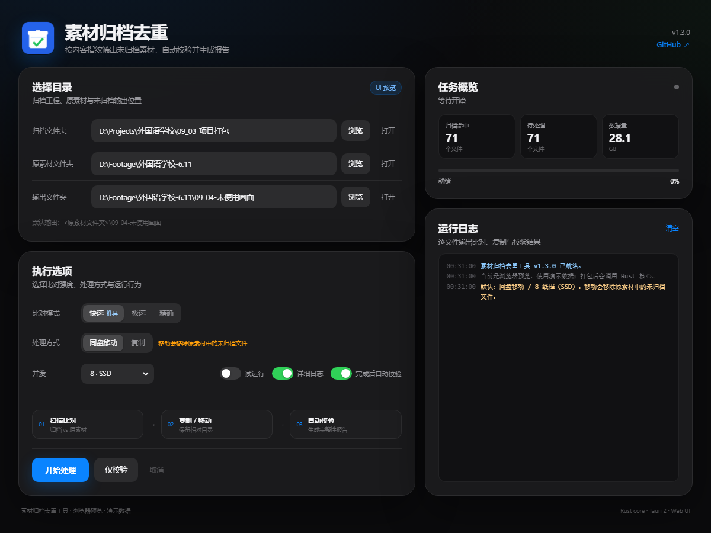

# ArchiveDedup · Tauri 2

素材归档去重工具的 **Tauri 2 + Rust** 重构版。



当前是 **Phase 0：Tauri 骨架 + Web UI 预览**。

- 界面：纯 HTML / CSS / JavaScript，深色苹果风，响应式布局
- 后端：Rust（Tauri 2），已接好目录选择、打开目录、进度事件、取消
- 扫描 / 复制 / 移动 / 校验：Phase 1 开始替换为真正的 Rust 实现
- 旧 Python 版暂时保留在 `../archive-dedup`，作为行为对照

## 直接预览 UI

`ui/index.html` 可以直接用浏览器打开。没有 Tauri 环境时会自动进入演示模式，使用示例路径和模拟进度。

## 本地开发

需要：

- Rust stable
- Visual Studio C++ Build Tools（MSVC）
- WebView2 Runtime（Windows 11 自带）
- Node.js 20+
- Tauri CLI 2

```bat
cd archive-dedup-tauri
npm install -g @tauri-apps/cli@^2
tauri dev
```

构建：

```bat
tauri build
```

产物：

```text
src-tauri\target\release\bundle\nsis\ArchiveDedup_1.3.0_x64-setup.exe
src-tauri\target\release\archive-dedup-tauri.exe
```

## GitHub Actions

`.github/workflows/build-tauri.yml` 使用 `windows-latest` 构建：

- 手动运行 `build-tauri`
- 或推送 `v1.3.0-tauri` 这类标签

构建完成后在 Actions 的 Artifacts 里下载 `ArchiveDedup-Tauri-windows`。

## 目录

```text
ui/                 HTML / CSS / JS
src-tauri/          Tauri + Rust
  src/lib.rs        命令注册、进度事件
  src/model.rs      前后端数据结构
  tauri.conf.json   窗口与打包配置
  icons/            应用图标
.github/workflows/  Windows 构建
```

## 迁移路线

- [x] Phase 0：Tauri 骨架 + 深色响应式 UI + 演示进度
- [ ] Phase 1：Rust 目录扫描、三种指纹、未归档清单
- [ ] Phase 2：复制 / 同盘移动 / 并发 / 取消
- [ ] Phase 3：输出校验、`归档完整性校验报告.txt`
- [ ] Phase 4：安装包、Release、与 Python 版结果对照

## 说明

Phase 0 的“开始处理 / 仅校验”只会跑演示进度，不会改动文件。真正的文件操作在 Phase 1/2 接入。
