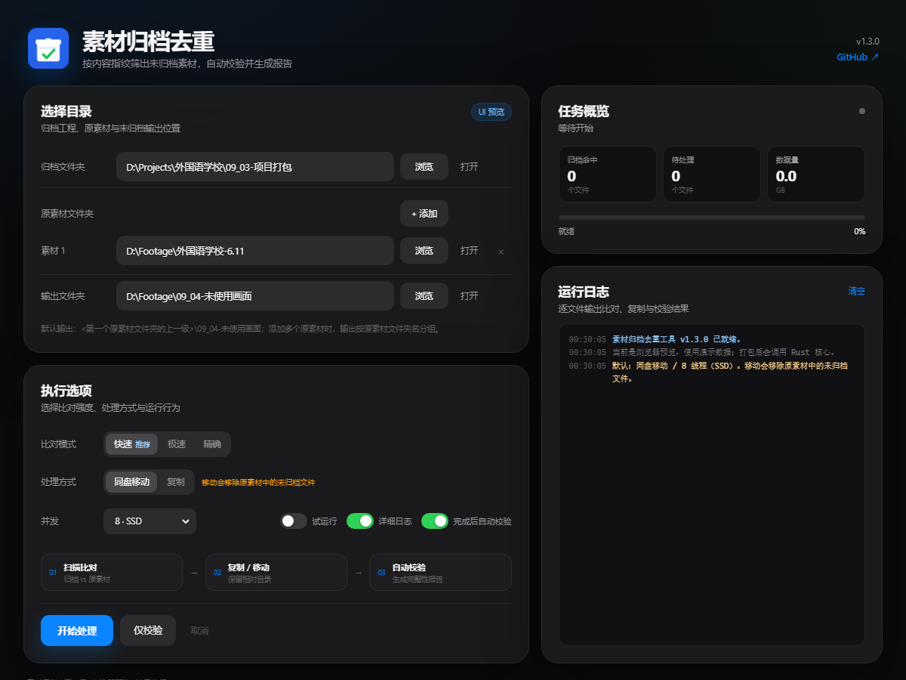

# ArchiveDedup · Tauri 2

素材归档去重工具的 **Tauri 2 + Rust** 重构版。



当前是 **Phase 4.1：多原素材 + 完整校验报告**：

- 界面：纯 HTML / CSS / JavaScript，深色苹果风，响应式布局
- 后端：Rust（Tauri 2），已接好目录选择、打开目录、进度事件、取消
- Phase 1：真实目录扫描、极速/快速/精确三种指纹、未归档清单
- Phase 2：并发复制、同盘移动、跨盘退化为复制、保留相对目录和 mtime
- Phase 3：输出校验、`归档完整性校验报告.txt`、自动校验、仅校验
- Phase 4：兼容 Python 版的 manifest、磁盘空间预检、NSIS 安装包
- Phase 4.1：**支持添加多个原素材文件夹**；报告列出归档目录、原素材目录、输出目录内每个文件的大小和指纹
- 旧 Python 版暂时保留在 `../archive-dedup`，作为行为对照

## 直接预览 UI

`ui/index.html` 可以直接用浏览器打开。没有 Tauri 环境时会自动进入演示模式，使用示例路径和模拟进度。

## 本地开发

需要：

- Rust stable
- Visual Studio C++ Build Tools（MSVC）
- WebView2 Runtime（Windows 11 自带）
- Node.js 20+
- Tauri CLI 2

```bat
cd archive-dedup-tauri
npm install -g @tauri-apps/cli@^2
tauri dev
```

构建：

```bat
tauri build
```

产物：

```text
src-tauri\target\release\bundle\nsis\ArchiveDedup_1.3.0_x64-setup.exe
src-tauri\target\release\archive-dedup-tauri.exe
```

## GitHub Actions

`.github/workflows/build-tauri.yml` 使用 `windows-latest` 构建：

- 先运行 `cargo test`（扫描、复制/移动、校验单元测试）
- 再执行 `tauri build`
- 手动运行 `build-tauri`
- 或推送 `v1.3.0-tauri` 这类标签

构建完成后在 Actions 的 Artifacts 里下载 `ArchiveDedup-Tauri-windows`。

## 目录

```text
ui/                 HTML / CSS / JS
src-tauri/          Tauri + Rust
  src/lib.rs        命令注册、进度事件
  src/model.rs      前后端数据结构
  src/scan.rs       目录扫描、三种指纹、未归档清单
  src/job.rs        并发复制/移动、mtime、进度
  src/verify.rs     输出校验、完整性报告
  src/manifest.rs   兼容 Python 版的复查清单
  tauri.conf.json   窗口与打包配置
  icons/            应用图标
.github/workflows/  Windows 构建
```

## 迁移路线

- [x] Phase 0：Tauri 骨架 + 深色响应式 UI + 演示进度
- [x] Phase 1：Rust 目录扫描、三种指纹、未归档清单（代码已接入，待 Windows 构建验证）
- [x] Phase 2：复制 / 同盘移动 / 并发 / 取消
- [x] Phase 3：输出校验、`归档完整性校验报告.txt`
- [x] Phase 4：manifest、磁盘预检、NSIS 安装包、Release
- [ ] 后续：代码签名、正式稳定版、更多等价性验证

## Phase 1 已实现

```text
archive / source / output
        ↓ walkdir
文件列表（跳过输出目录和清单/报告）
        ↓
极速：size + mtime
快速：size + head64KB MD5 + tail64KB MD5
精确：size + 全量 MD5
        ↓
归档指纹集合 vs 原素材
        ↓
ScanSummary：archived / unique / unique_bytes / unique_files
```

## Phase 2 已实现

```text
ScanSummary.unique_items
        ↓
输出目录 + 相对路径
        ↓
复制：.part 临时文件 → 替换目标
移动：同盘 rename；失败时复制后删源
        ↓
并发线程池（1–32，默认 8）
        ↓
保留 mtime、进度、取消、失败汇总
```

复制到输出目录时使用 `.part` 临时文件，避免中断留下半个文件；同盘移动优先 `rename`，跨盘自动退化为复制。

## Phase 3 已实现

```text
复制/移动完成
        ↓
按相同模式重新计算输出文件指纹
        ↓
比对：缺失 / 不一致 / 多余
        ↓
写 归档完整性校验报告.txt
  - 项目名称、生成时间、版本、GitHub
  - 比对模式、处理方式、输出目录
  - 逐文件大小和指纹
  - 集合 SHA256
```

“完成后自动校验”默认开启；“仅校验”会重新扫描归档/原素材并检查输出目录，不复制文件。

## Phase 4 已实现

- 输出目录写入 `_archive_dedup_manifest.json`
  - `version: 1`
  - 模式、处理方式、源目录、归档目录
  - 源文件数量/字节数
  - 每个未归档文件的 `rel`、`size`、`key`
- 复制前用 `fs2` 检查输出磁盘剩余空间
- NSIS 安装包与便携版 exe
- GitHub Release 自动/手动构建

manifest 的 `mode` 和 `copy_mode` 使用 Python 版同样的中文标签，`key` 数组也保持兼容。

## 多原素材文件夹

界面的“原素材文件夹”支持：

- 点“+ 添加”增加第二个、第三个素材目录
- 每个目录独立选择 / 打开 / 移除
- 单目录保持原来输出结构；多目录时输出自动加一层“原素材文件夹名”，避免相对路径冲突

## 完整目录校验值

`归档完整性校验报告.txt` 现在包含四部分：

1. 未归档源文件 → 输出文件的逐项对账
2. 归档目录每个文件的大小和指纹
3. 原素材目录每个文件的大小、指纹、已归档/未归档状态
4. 输出目录每个文件的大小、指纹、一致/不一致/多余状态

报告样例：[docs/report-sample.txt](docs/report-sample.txt)

## 说明

浏览器预览的“开始处理 / 仅校验”是演示进度；Tauri 版会执行真实扫描、复制/移动、校验和清单写入。
